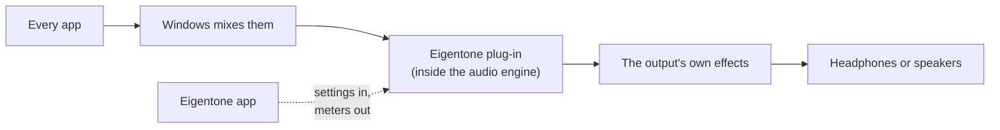

<p align="center">
  
</p>

<h1 align="center">Eigentone for Windows</h1>

<p align="center">
  <b>A free, open-source equaliser for Windows that tunes every app to your headphones, your speakers and your ears.</b><br>
  No ads. No account. No tracking.
</p>

<p align="center">
  <a href="LICENSE"></a>
  
  
</p>

This is the Windows version of [Eigentone for Android](https://github.com/Dragjon/eigentone), with the same sound, the same presets and the same idea: **simple by default, powerful when needed**.

> [!WARNING]
> Eigentone for Windows is in early development and there's nothing to install yet. It hooks into Windows' audio engine, so until the first release, only try builds if you're comfortable restoring your audio with `eigentone-setup uninstall`.

## How it works

Eigentone adds a small audio plug-in to each output you choose, so it shapes every app at once: games, browsers, Spotify and calls. It's the same method Equalizer APO has used for years, with no virtual cable to route sound through.



| Part | Written in | What it does |
|---|---|---|
| **Plug-in** (`engine/apo`) | C++ | Processes the sound in real time inside Windows' audio engine |
| **Service** (`engine/service`) | C++ | Starts with Windows, keeps the last settings, hooks new outputs, tells the app what's playing, and sends meters |
| **Setup tool** (`engine/setup`) | C++ | Installs everything, and puts each output back exactly as it was |
| **App** (`app`, coming) | Kotlin, Compose Multiplatform | The interface, shared in logic and design with the Android app |

The full plan, and why each choice was made, is in [the plan](docs/PLAN.md).

## Building

You need Visual Studio 2022 with the C++ desktop workload, and CMake 3.24 or newer.

```powershell
cmake -S . -B build -G "Visual Studio 17 2022" -A x64
cmake --build build --config Release
ctest --test-dir build -C Release   # runs the plug-in outside the audio engine first
```

To try it, run as administrator from `build\bin`:

```powershell
.\eigentone-setup install        # installs the plug-in and the service, and hooks your default output
.\eigentone-setup status         # shows whether the plug-in is processing
.\eigentone-setup devices        # every output, and what Eigentone takes it to be
.\eigentone-setup set tone 6 0   # more bass, live (also: compressor, surround, reverb, limiter, on, off)
.\eigentone-setup uninstall      # removes everything and restores every output exactly as it was
```

The app talks to the service over `\\.\pipe\eigentone`, one JSON message per line: `hello`, `outputs`, `params`, `apply`, `status`, `meters`, `hook`, `unhook` and `restartAudio`.

## License

Eigentone is free software under the [GNU General Public License v3.0](LICENSE).
