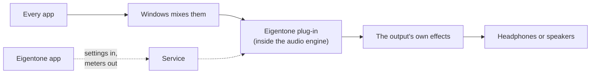

<p align="center">
  
</p>

<h1 align="center">Eigentone for Windows</h1>

<p align="center">
  <b>A free, open-source equaliser for Windows that tunes every app to your headphones, your speakers and your ears.</b><br>
  No ads. No account. No tracking.
</p>

<p align="center">
  <a href="LICENSE"></a>
  
  
</p>

This is the Windows version of [Eigentone for Android](https://github.com/Dragjon/eigentone), with the same sound, the same presets and the same idea: **simple by default, powerful when needed**. On a PC it's laid out as an audio studio: the curve in the middle, presets and history on the left, every effect on the right.

## Install

1. Download `Eigentone-<version>-setup.exe` from [Releases](https://github.com/Dragjon/eigentone-windows/releases).
2. Run it. It asks for administrator rights once, to add Eigentone to Windows audio. **Sound pauses for a moment** while Windows audio restarts.
3. Eigentone opens on a short setup.

Builds aren't code-signed yet, so Windows SmartScreen may say the publisher is unknown. Choose **More info**, then **Run anyway**.

To remove it, use **Settings › Apps › Installed apps › Eigentone › Uninstall**. Every output's effects are put back exactly as they were before Eigentone, then the files are removed. Your presets stay in `%APPDATA%\Eigentone` in case you come back.

## What it does

| Module | What's in it |
|---|---|
| **Tune** | Graphic EQ (10, 15 or 31 faders, all on screen) and a parametric EQ, 350 shapes, tone, preset strength, surround, reverb, Clarity, a 3-band compressor, the limiter, and History with Undo and Redo |
| **Presets** | Your presets and the built-in ones, favourites, folders, share codes, EQ files, backups, and a preset per app |
| **Devices** | Every output Windows is playing to, a preset and correction for each, AutoEq headphone corrections, your ears, and quiet listening |
| **Tools** | Find my sound, Refine my sound, the hearing check, Find peaks, the frequency sweep, measuring a speaker with a microphone, and comparisons, blind or not |
| **Settings** | Volume and night mode, level and the limiter, appearance, accessibility, shortcuts, and status |

Outside the window:

- **Tray icon:** on and off, Bypass and the presets. Closing the window leaves Eigentone running there.
- **Shortcuts from any app:** <kbd>Ctrl</kbd>+<kbd>Alt</kbd>+<kbd>B</kbd> Bypass, <kbd>Ctrl</kbd>+<kbd>Alt</kbd>+<kbd>E</kbd> on and off, <kbd>Ctrl</kbd>+<kbd>Alt</kbd>+<kbd>→</kbd>/<kbd>←</kbd> next and previous preset.
- **Per-app presets:** a preset loads when the app you've given it starts playing, such as Spotify or a game.
- **Starts with Windows**, in the tray, if you want it to.

## Good to know

- **Turn off Windows' audio enhancements for the best results.** Some sound drivers change the sound before Eigentone does, for example Realtek's Loudness Equalization. The hearing check and the other level tools check for this before they start, and say how to turn it off: **Settings › System › Sound**, choose the output, set **Audio enhancements** to **Off**.
- **Use one EQ at a time.** EQ in other software, such as Realtek Audio Console, Dolby Access, Nahimic or your headphones' own app, adds to Eigentone's.
- **The EQ keeps working with the app closed.** The background service keeps your sound. The app is needed for quiet listening, per-app presets, the tray and the shortcuts.
- Windows 11 is required, and x64 PCs only for now.

## How it works

Eigentone adds a small audio plug-in (an APO) to each output, so it shapes every app at once: games, browsers, Spotify and calls. It's the same method Equalizer APO has used for years, with no virtual cable to route sound through.



| Part | Written in | What it does |
|---|---|---|
| **Plug-in** (`engine/apo`) | C++ | Processes the sound in real time inside Windows' audio engine: a 256-band EQ per ear, compressor, surround, reverb and limiter |
| **Service** (`engine/service`) | C++ | Starts with Windows, keeps the last settings, hooks new outputs, and passes settings, meters and the volume between the app and the plug-in |
| **Agent** (`engine/agent`) | C++ | Runs in your session and tells the app which apps are playing, for per-app presets |
| **Setup tool** (`engine/setup`) | C++ | Hooks the plug-in in, and puts each output back exactly as it was |
| **App** (`app`) | Kotlin, Compose Multiplatform | The interface, sharing its presets, curves and tools with the Android app |

The full plan, and why each choice was made, is in [the plan](docs/PLAN.md).

## Building

You need Visual Studio 2022 with the C++ desktop workload, CMake 3.24 or newer, a JDK 17 or newer, and [Inno Setup 6](https://jrsoftware.org/isinfo.php) for the installer.

```powershell
cmake -S . -B build -A x64
cmake --build build --config Release
ctest --test-dir build -C Release        # the plug-in, run outside the audio engine first
.\gradlew.bat :app:test :app:createDistributable
& "${env:ProgramFiles(x86)}\Inno Setup 6\ISCC.exe" installer\eigentone.iss   # build\installer\Eigentone-0.1.0-setup.exe
```

For a quick try without the installer, run as administrator from `build\bin`:

```powershell
.\eigentone-setup install        # installs the plug-in and the service, and hooks your default output
.\eigentone-setup status         # shows whether the plug-in is processing
.\eigentone-setup uninstall      # removes everything and restores every output exactly as it was
```

The app talks to the service over `\\.\pipe\eigentone`, one JSON message per line.

## Licence

Eigentone is free software under the [GNU General Public License v3.0](LICENSE).
