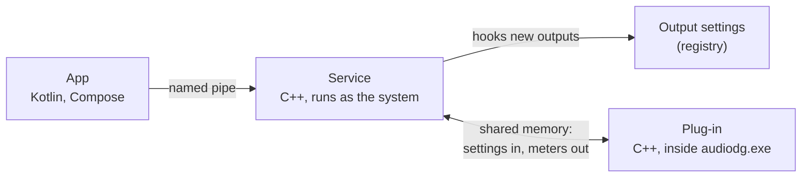

# The plan

[← Back to the README](../README.md)

How Eigentone for Windows is built, why, and in what order.

## How sound gets processed

Android has a system effect, `DynamicsProcessing`, that does the sound processing and that Eigentone configures. Windows has nothing like it, so Eigentone brings its own processing and puts it into Windows' audio engine.

| Way to process every app | Verdict |
|---|---|
| **Our own audio plug-in (an APO) for each output** | **Chosen.** Every app, a few milliseconds of delay at most, and no virtual device. It's how Equalizer APO has worked for over ten years. |
| Build on Equalizer APO | A second program to install, settings passed through a text file, no compressor without extra plug-ins, and no meters. |
| A virtual audio device | Needs a kernel driver signed by Microsoft. |

### Where the plug-in sits

Windows 11 lets an output run a list of endpoint effects, one after another, stored in the output's registry key under `FxProperties` as `{d04e05a6-594b-4fb6-a80d-01af5eed7d1d},15`. Eigentone puts itself first in that list. The driver's own effects, like speaker protection, still run after it, and nothing of theirs has to be wrapped or replaced.

The setup tool saves the list exactly as it was before changing it, and uninstalling writes that back.

## Languages and frameworks

| Part | Choice | Why |
|---|---|---|
| **Plug-in and sound processing** | C++20, CMake | It runs in real time inside `audiodg.exe`, so it must never pause, allocate or wait. Windows' APO interfaces are COM, written for C++. |
| **Background service** | C++ | Starts with Windows, hooks newly connected outputs, and owns the shared memory that settings and meters travel through. |
| **App** | Kotlin, Compose Multiplatform for desktop | About 5,500 lines of the Android app's logic carry over almost unchanged: presets, AutoEq, the shape library, the hearing check, *Find my sound*, ramping and share codes. So does its design. |
| **Installer** | Inno Setup | Registering the plug-in needs administrator rights, and uninstalling must leave Windows audio exactly as it was. |
| **CI** | GitHub Actions on Windows | Builds and tests every push, for x64 and ARM64. |

The app bundles a trimmed Java runtime, so the download is around 80 to 100 MB. The plug-in itself is tiny.

## Architecture

The app adds every curve together into one target curve, as on Android: the preset, the graphic EQ, tone, headphone correction, ear correction and quiet listening. The plug-in turns that curve into a minimum-phase filter for each channel, with no 128-band limit, and crossfades from the old filter to the new one so changes morph instead of clicking.

**The plug-in's chain:** input gain, then EQ, then dynamic EQ (Clarity), then the 3-band compressor, then width and balance, then surround, then reverb, then the limiter.

## Features on Windows

Everything that isn't listed here works as it does on Android: both EQs, the 350 shapes, AutoEq, the hearing tools, comparisons, presets, the dynamics, Undo and Redo, Save and Discard, accessibility, and themes.

| On Android | On Windows |
|---|---|
| Device tabs: Phone, Headphones, Earbuds, Speaker, Car | Laptop speakers, Speakers, Headphones, Earbuds, TV or monitor (HDMI and DisplayPort), USB DAC. Worked out from the output's form factor, connection and name. |
| A preset per app | A preset per app, loaded when that app starts playing sound |
| Quick Settings tile, widget, app shortcuts | A tray icon with on/off, presets and a meter. Also global hotkeys, taskbar shortcuts, and starting with Windows. |
| Material You colours | The Windows accent colour, or any hue you pick |
| Measure a speaker | The PC's microphone or a USB measurement microphone, for desk speakers and TVs |
| Reverb and surround on apps that announce their audio | On everything |
| Earbud noise mode | Not available: Windows doesn't report it |
| Share codes and backups | The same format, so presets move between your phone and your PC |

## Known limits

- Apps using exclusive mode bypass every plug-in. That includes some music-production software and ASIO output.
- A few Bluetooth or audio-offload drivers skip plug-ins.
- A major Windows update can occasionally reset an output's effects. The service hooks it again.
- Builds aren't code-signed yet, so SmartScreen warns about an unknown publisher.

## Milestones

| | Milestone | Done when |
|---|---|---|
| M0 | Repo, layout, CI, licence, README | It builds on GitHub |
| **M1** | **A plug-in that passes sound through with a level change, plus install and uninstall** | **The level changes audibly on a real output, and uninstalling restores it** |
| M2 | The sound processing: filter, ramping, limiter, compressor, dynamic EQ, width, surround, reverb | Unit tests against reference responses, and no clicks when switching |
| M3 | Service, settings, output detection, meters and spectrum | The device tab follows what's plugged in |
| M4 | The app: models, presets, AutoEq, shapes, both EQs, Effects, Settings, device tabs | Usable every day |
| M5 | Tools: hearing check, *Find my sound*, *Refine my sound*, peak finder, sweep, compare, measure a speaker | Feature parity with Android |
| M6 | Windows extras: tray, hotkeys, starting with Windows, per-app presets, night schedule, share codes between devices | |
| M7 | Docs, installer, and the 0.1.0 pre-release | |
